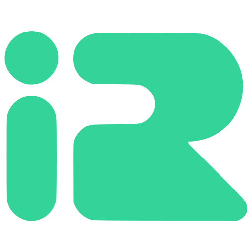

<p align="center">
  
</p>

<h1 align="center">IranRouter Examples</h1>

<p align="center">
  نمونه‌کدهای آماده برای کار با <a href="https://iranrouter.net">IranRouter</a>
</p>

IranRouter یک API سازگار با OpenAI است.
فقط Base URL و کلید را عوض کنید.

| مورد | مقدار |
|------|--------|
| Base URL | `https://iranrouter.net/api/v1` |
| Auth | `Authorization: Bearer ir-…` |
| Env | `IRANROUTER_API_KEY` |
| Docs | https://iranrouter.net/docs |

راهنمای اختصاصی پایتون: [iranrouterPython](https://github.com/BytelabsTeam/iranrouterPython)

## شروع سریع

1. کلید `ir-…` را از [داشبورد ← کلیدها](https://iranrouter.net/dashboard/keys) بگیرید.
2. فایل env را بسازید:

```bash
cp .env.example .env
# IRANROUTER_API_KEY را داخل .env بگذارید
```

3. یکی از نمونه‌ها را اجرا کنید.

## ساختار

```text
curl/      # اسکریپت‌های curl
python/   # نمونه‌های Python (OpenAI SDK)
node/     # نمونه‌های Node.js (OpenAI SDK)
assets/   # لوگو
```

## curl

```bash
export IRANROUTER_API_KEY="ir-..."
chmod +x curl/*.sh

./curl/chat.sh
./curl/stream.sh
./curl/models.sh
./curl/key.sh
./curl/embeddings.sh
./curl/images.sh
```

## Python

```bash
cd python
pip install -r requirements.txt
python chat.py
python stream.py
python models.py
python check_key.py
python embeddings.py
python images.py
```

نمونهٔ کوتاه:

```python
from openai import OpenAI

client = OpenAI(
    api_key="ir-...",
    base_url="https://iranrouter.net/api/v1",
)

r = client.chat.completions.create(
    model="deepseek/deepseek-flash",
    messages=[{"role": "user", "content": "سلام"}],
)
print(r.choices[0].message.content)
```

## Node.js

```bash
cd node
npm install
npm run chat
npm run stream
npm run models
npm run key
npm run embeddings
npm run images
```

نمونهٔ کوتاه:

```js
import OpenAI from "openai";

const client = new OpenAI({
  apiKey: process.env.IRANROUTER_API_KEY,
  baseURL: "https://iranrouter.net/api/v1",
});

const r = await client.chat.completions.create({
  model: "deepseek/deepseek-flash",
  messages: [{ role: "user", content: "سلام" }],
});

console.log(r.choices[0].message.content);
```

## فهرست نمونه‌ها

| موضوع | curl | Python | Node |
|------|------|--------|------|
| چت | `curl/chat.sh` | `python/chat.py` | `node/chat.mjs` |
| استریم | `curl/stream.sh` | `python/stream.py` | `node/stream.mjs` |
| مدل‌ها | `curl/models.sh` | `python/models.py` | `node/models.mjs` |
| وضعیت کلید | `curl/key.sh` | `python/check_key.py` | `node/check-key.mjs` |
| Embedding | `curl/embeddings.sh` | `python/embeddings.py` | `node/embeddings.mjs` |
| تصویر | `curl/images.sh` | `python/images.py` | `node/images.mjs` |

## مدل‌های پیشنهادی برای تست

- `deepseek/deepseek-flash`
- `openai/gpt-4o-mini`
- `iranrouter/demo-embed`
- `openai/gpt-image-2.5-sunburst`

کاتالوگ کامل: https://iranrouter.net/models

## لینک‌ها

- سایت: https://iranrouter.net
- مستندات API: https://iranrouter.net/docs
- SDK پایتون: https://github.com/BytelabsTeam/iranrouterPython
- کلیدها: https://iranrouter.net/dashboard/keys

## کمک و مشارکت

اگر راهنمایی، مثال بیشتر، یا بهبودی لازم داشتید:

- در [Issues](https://github.com/BytelabsTeam/iranrouter-examples/issues) بنویسید
- یا درخواست‌تان را در [Wiki](https://github.com/BytelabsTeam/iranrouter-examples/wiki) بگذارید

MIT — [Bytelabs](https://github.com/BytelabsTeam)
